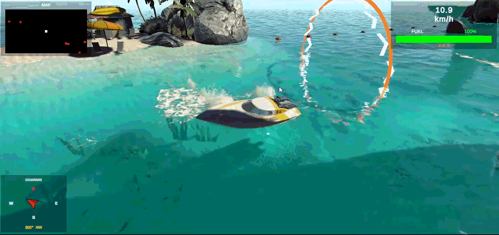
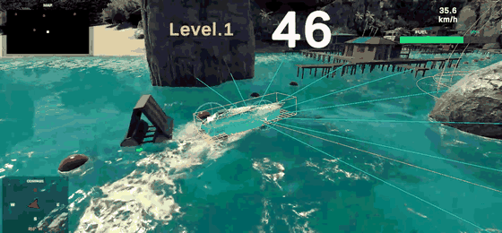
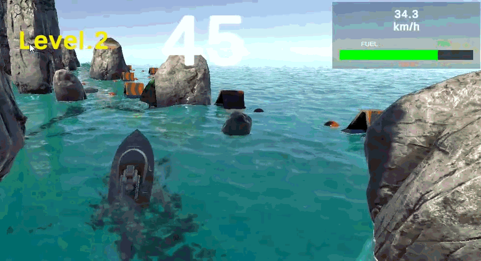

# Unity 기반 해양 모빌리티 항로 주행 시뮬레이터 (6조)

2026년 1학기 **IT 기반 해양 모빌리티 시스템** Term-Project 팀 과제입니다.

선박을 조종해 출발 지점에서 체크포인트를 통과하고, 제한 시간 안에 목적지까지 가는 시뮬레이터입니다. 키보드로 직접 몰 수도 있고, V키를 누르면 자율운항 모드로 바뀌어 장애물을 피하면서 스스로 목적지까지 갑니다.



## 출처

해양 환경(바다·섬·파도·물 렌더링)과 보트 모델은 Unity Technologies의 데모 프로젝트 [Boat Attack](https://github.com/Unity-Technologies/BoatAttack)을 가져와 사용했습니다. 원본 라이선스는 `come/LICENSE.md`(Unity Companion License)에 있습니다.

그 위에 항로·장애물 배치, 시뮬레이션 흐름, HUD, 자율운항, 난이도 구분을 팀에서 새로 만들었습니다. 어떤 파일이 원본이고 어떤 파일이 새로 작성한 것인지는 아래 [파일 구성](#파일-구성)에 정리했습니다.

## 시뮬레이션 규칙

| | 내용 |
|---|---|
| 목표 | 출발 지점 → 체크포인트 통과 → 제한 시간(60초) 안에 목적지 도착 |
| 성공 (FINISH) | 목적지 링(DestinationTrigger)에 도달 |
| 실패 (FAIL) | 연료가 다 떨어지거나 제한 시간 초과 |
| 연료 | 60초 동안 100% → 0%로 일정하게 줄고, 장애물에 한 번 부딪힐 때마다 5%씩 추가로 줄어듦 |

진행 순서는 `타이틀 화면 → (Space) → 대기 → 체크포인트 통과 → START 표시 2초 → 타이머 시작 → FINISH 또는 FAIL`이고, R키를 누르면 처음 위치와 연료 100%로 돌아갑니다.

## 조작

| 키 | 동작 |
|---|---|
| Space | 타이틀 화면 넘기기 |
| W / S | 전진 / 후진 |
| A / D | 좌회전 / 우회전 |
| V | 자율운항 켜기/끄기 (자율운항 중에 WASD를 누르면 바로 수동으로 전환) |
| R | 처음 위치·연료로 재시작 |
| T, F | (테스트용) 체크포인트 통과 / 목적지 도착 처리 |

## 주요 기능

### 1. 선박 조작과 물리 — `BoatController.cs`

Rigidbody에 `AddForce`(전진/후진)와 `AddTorque`(Y축 회전)를 주는 방식입니다. 이동 방향의 y 성분을 0으로 만들어 수면 위에서만 움직이게 했고, `ForceMode.Acceleration`을 써서 질량과 상관없이 일정하게 가속됩니다. 속도와 회전값은 Inspector에서 조정할 수 있습니다.

### 2. 해상 환경

바다, 섬, 암초, 부표, 안개, 파도로 구성했습니다. 파도·부력·물 렌더링은 Boat Attack에 들어 있는 기능을 그대로 활용했습니다.

- **Gerstner 파도**: `Water.cs`가 파도 데이터를 만들고, 화면에 그리는 쪽은 GPU(ComputeBuffer), 선박 부력 계산은 CPU(`GerstnerWavesJobs`, Burst + IJobParallelFor)가 매 프레임 수면 높이를 계산해 처리합니다. 단순한 sin 파와 달리 마루가 뾰족한 실제 파도 모양이 나옵니다.
- **물 렌더링**: URP Renderer Feature(`WaterSystemFeature`)에서 거품·노말·변위를 렌더 텍스처에 담는 `WaterFxPass`와 빛 굴절 무늬를 투영하는 `WaterCausticsPass`를 씁니다.
- **안개 / 낮·밤**: `FogOverride.cs`, `DayNightController.cs`
- **이동 장애물** (팀 작성): `WindsurferMover.cs`가 윈드서퍼 오브젝트를 웨이포인트를 따라 계속 순환시킵니다. `Windsurfer_PatrolGroup` 프리팹으로 여러 곳에 재사용했고, 에디터 메뉴 `Tools > Setup Windsurfer Colliders`로 충돌체를 한 번에 붙입니다.

### 3. 시뮬레이션 흐름 — `Simulation_Manager.cs`

타이틀, 대기, 진행, 성공/실패 화면 전환과 타이머를 한곳에서 관리합니다. 체크포인트(`CheckpointTrigger.cs`)를 지나면 타이머가 시작되고, 목적지(`DestinationTrigger.cs`)에 닿거나 연료·시간이 다 떨어지면 FINISH/FAIL로 넘어갑니다.

### 4. HUD — `BoatHUD.cs`, `MinimapHUD.cs`

| 항목 | 방식 |
|---|---|
| 속도계 | `Rigidbody.velocity.magnitude × 3.6` → km/h |
| 연료 게이지 | 시간 비례 감소 + 충돌 시 추가 감소, 0이 되면 FAIL |
| HIT 카운터 | 충돌 횟수 누적 |
| 나침반 | 선박 Y축 회전각으로 바늘 회전, N / NE / E … 8방위 표시 |
| 미니맵 | 장애물 그룹(`Obstacles_Left`, `Obstacles_Right`)의 위치를 선박 기준 상대 좌표로 바꿔 빨간 점으로 표시 |

### 5. 자율운항과 장애물 회피 — `BoatAutoNav.cs`

V키를 누르면 씬에 배치한 웨이포인트를 순서대로 지난 뒤 목적지로 갑니다.



- 선수 기준 0°, ±20°, ±45°, ±70°, ±90° 9방향으로 레이캐스트를 쏴서 장애물을 감지합니다.
- 장애물이 가까울수록 가중치(`1 - 거리/감지거리`)가 커져 반대쪽으로 더 세게 꺾습니다.
- 정면이 완전히 막혔는데 좌우 판단이 안 서면 기본으로 우회전해서 빠져나갑니다.
- 목표 방향 각도와 회피 값을 합쳐 조향을 정하고, 일정 속도로 전진합니다.

### 6. 난이도 구분

체크포인트 링마다 Inspector에서 `level` 값을 1 또는 2로 정해두면, 통과할 때 화면에 "Level.1" / "Level.2"가 표시됩니다.

- **Level 1**: 넓은 항로, 장애물 적음
- **Level 2**: 좁은 암벽 협로, 장애물 밀집



## 파일 구성

팀에서 새로 작성한 파일:

| 파일 | 역할 |
|---|---|
| `Assets/BoatController.cs` | WASD 수동 조종 |
| `Assets/WindsurferMover.cs` | 이동 장애물 웨이포인트 순환 |
| `Assets/Scripts/BoatAutoNav.cs` | 자율운항, 장애물 회피, R키 재시작 |
| `Assets/Scripts/Simulation_Manager.cs` | 시뮬레이션 흐름, 타이머 |
| `Assets/Scripts/CheckpointTrigger.cs` | 체크포인트 통과, 레벨 전달 |
| `Assets/Scripts/DestinationTrigger.cs` | 목적지 도착 판정 |
| `Assets/Scripts/BoatHUD.cs` | 속도·연료·HIT·나침반 |
| `Assets/Scripts/MinimapHUD.cs` | 미니맵 |
| `Assets/Scripts/Editor/GameSetup.cs`, `HUDSetup.cs`, `CheckpointSetup.cs`, `WindsurferSetup.cs` | 에디터 `Tools` 메뉴에서 UI·HUD·체크포인트·충돌체 자동 배치 |

Boat Attack 원본을 그대로 쓴 주요 파일: `Assets/Scripts/Boat/` (Engine, Boat 등), `Assets/Scripts/Environment/` (FogOverride, DayNightController 등), `Packages/com.verasl.water-system/` (파도·물 렌더링)

## 실행 방법

1. Unity **2022.3.62f3** 버전을 설치합니다.
2. 이 저장소는 이미지·모델 파일을 Git LFS로 관리합니다. [Git LFS](https://git-lfs.com)를 설치한 뒤 clone 해야 텍스처가 제대로 받아집니다. (ZIP 다운로드로는 LFS 파일이 빠질 수 있습니다.)
   ```
   git lfs install
   git clone https://github.com/kyuyeon76/team6-unity-boat-project.git
   ```
3. Unity Hub에서 `come` 폴더를 프로젝트로 엽니다.
4. `Assets/Scenes/_levels/level_Island.unity` 씬을 열고 Play를 누릅니다.
